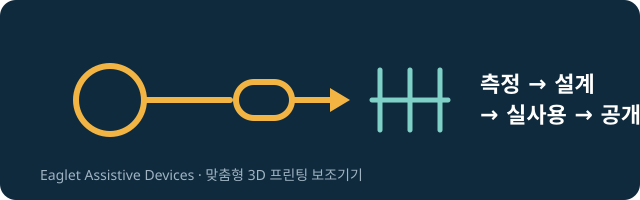

<h1 align="center">Eaglet Assistive Devices</h1>

<p align="center">
  
</p>

<p align="center"><b>한 사람의 불편을, 다음 사람이 다시 쓸 수 있는 설계로.</b><br>장애인·고령자의 일상동작 하나를 맞춤형 3D 프린팅 보조기기로 해결하고, 그 과정을 재사용 가능한 기록으로 남기는 저장소입니다.</p>

<p align="center">
  
  
  
  
</p>

<p align="center">
  <a href="docs/guide.md">제작 가이드</a> ·
  <a href="docs/evaluation.md">평가 기준</a> ·
  <a href="docs/prior-art.md">선행 사례</a> ·
  <a href="docs/references.md">참고문헌</a> ·
  <a href="reference/">참조 사례</a> ·
  <a href="docs/privacy.md">개인정보 원칙</a> ·
  <a href="cases/">사례</a>
</p>

---

손에 힘이 부족해 숟가락을 쥐기 어렵거나, 손목이 돌아가지 않아 문고리를 열 때마다 도움을 받아야 하는 불편은 사람마다 형태와 치수가 다릅니다. 규격 제품은 맞지 않고, 개별 맞춤 제작은 비싸고 멀리 있습니다.

공개된 보조기기 라이브러리는 **완성된 설계**를 공유합니다. 이 저장소는 그 앞뒤를 남깁니다. 한 사람의 문제가 **어떤 측정값과 설계 조건**이 됐는지, **실제 생활에서 2주 이상 써 보니** 무엇이 틀렸고 어떻게 고쳤는지를 사례마다 같은 형식으로 기록해, 비슷한 사용자를 만난 다음 제작자가 처음부터 다시 풀지 않아도 되게 하는 것이 목표입니다.

연세대학교 공과대학 학생팀 **아기독수리**가 2026-2 IHEI WORKSTATION 지원으로 수행합니다.

## 원칙

- **문제부터, 제품은 나중에.** 만들 기기를 정해 놓고 사용자를 찾지 않습니다. 면담과 측정으로 목표 동작 하나를 정합니다.
- **있는 것부터.** 국내외 공개 설계를 먼저 찾아 사용자 치수에 맞게 고치고, 없을 때만 새로 설계합니다.
- **만들었다가 아니라 도움이 됐는가.** 1차 시제품은 최소 14일 실사용 후 평가하고 최소 1회 개선합니다. 효과는 만족도가 아니라 처음 정한 목표 동작으로 판단합니다.
- **원본 데이터는 저장소 밖에.** 공개되는 것은 익명 사례 ID와 설계에 필요한 치수뿐입니다.

> **만들지 않는 것**: 체중을 지지하는 기기(지팡이, 보행·이승 보조 등)와 치료 목적의 기기(교정용 보조기, 스플린트 등). 학생팀이 안전을 충분히 검증할 수 없기 때문입니다. 이 저장소의 설계를 그런 용도로 쓰지 마세요.

## 참조 사례: 연구 결과로 끝까지 따라가 본 세 가지

실제 참여자를 만나기 전에, 면담과 실사용이 필요한 단계를 **발표된 연구 결과로 대신해** 절차 전체를 한 번 끝까지 진행했습니다. **실제 사람이 아니며**, 지어낸 평가 데이터를 넣지 않았고, 사업계획서의 정량 목표에도 포함되지 않습니다.

| 사례 | 목표 동작 | 근거 | 결과로 나온 설계 |
|---|---|---|---|
| [ref-01](reference/ref-01-eating/) | 숟가락으로 식사 | 류마티스 관절염 환자 35명: 손잡이가 굵을수록 손가락 굽힘 감소, 29명이 38.1 mm 선택 [R1]; 손잡이 지름 = 손 길이의 19.7% [R3] | 25.4 / 32 / 38.1 mm 굵은 손잡이 세 개를 출력해 고르게 함 |
| [ref-02](reference/ref-02-door-knob/) | 원형 문고리 열기 | 조작력 22.2 N 이하·비틀기 금지 [R5], 회전 토크 상한 3.16 N·m [R6], PETG 강도 [R7] | 150 mm 레버 캡, 200 N 오용 하중에서 안전율 2.13 |
| [ref-03](reference/ref-03-writing/) | 펜으로 쓰기 | 기존 공개 설계 Pen Ball, Palm Pen Holder [R15] | 새로 만들지 않고 기존 설계를 1순위로 |

각 사례는 실제 사례와 같은 문서(요구사항, 설계 근거, 출력 조건, 전달 전 점검)를 갖추고, 평가 대신 `expected-outcomes.md`에 **연구가 보고한 결과와 할 수 없는 말**을 적었습니다. 근거마다 원문/초록/2차 중 어디까지 확인했는지는 [참고문헌](docs/references.md)에 표시했습니다.

## 저장소 구성

| 위치 | 단계 | 내용 |
|---|---|---|
| [`docs/guide.md`](docs/guide.md) | 전체 | 맞춤형 보조기기 제작 가이드: 절차, 일정, 소재 선택, 점검 |
| [`docs/prior-art.md`](docs/prior-art.md) | 시작 전 | 국내외 공개 플랫폼과 연구 근거 조사 (2026-11-20) |
| [`cases/_template/`](cases/_template/) | 1–5 | 사례 하나의 기록 양식: 면담, 요구사항, 설계 근거, 제작, 전달 전 점검, 평가, 변경 이력 |
| [`cad/`](cad/) | 2 | 매개변수 OpenSCAD 시작 모델: 굵은 식기 손잡이, 문고리 레버 |
| [`tools/design_params.py`](tools/design_params.py) | 2 | 측정값 → 시작 설계 치수 (손잡이 지름, 레버 길이·강도). 규칙마다 근거 표기 |
| [`reference/`](reference/) | 1–5 | 연구 결과로 구성한 참조 사례 3건 |
| [`docs/references.md`](docs/references.md) | 전체 | 참고문헌 R1–R19, 확인 수준, 찾지 못한 근거 |
| [`docs/evaluation.md`](docs/evaluation.md) | 4 | 5개 공통 평가 항목과 척도, KPI 정의 |
| [`tools/at_eval.py`](tools/at_eval.py) | 4–5 | 사업계획서의 정량 목표를 사례 기록으로 판정 |
| [`tools/check_privacy.py`](tools/check_privacy.py) | 커밋 전 | 전화번호·주민번호·이메일 패턴 검사 (CI에서도 실행) |

사례 폴더 구성은 [Makers Making Change](https://github.com/makersmakingchange)의 기기별 문서 세트(설계 근거, 제작 체크리스트, 부품 목록, 출력 가이드, 변경 이력)를 따르고, 면담·요구사항·실사용 평가를 더했습니다.

## 사용법

**새 사례 시작** — 별도 설치 없이 템플릿을 복사해 채웁니다.

```sh
cp -r cases/_template cases/case-01
```

**목표 달성 확인** — Python 3 표준 라이브러리만 씁니다 (CI는 3.12).

```sh
python3 tools/at_eval.py
```

아직 기록된 사례가 없는 현재 상태의 실제 출력입니다. `PENDING`은 데이터가 아직 없다는 뜻, `FAIL`은 기록된 데이터가 목표에 못 미친다는 뜻입니다.

```
PENDING  users with a baseline record >= 3        0
PENDING  v1 used >= 14 days                       no cases
PENDING  at least 1 revision (v2+)                no cases
PENDING  KPI: improved users >= 2/3               0/0 improved
PENDING  published designs (stl/) >= 3            0
```

**시작 설계 치수 계산** — 문고리 토크를 아직 재지 못했을 때(표준 상한으로 설계)의 실제 출력입니다.

```
$ python3 tools/design_params.py lever
Design torque              : 3.16 N*m
Lever length [R5, R6]      : >= 148 mm  (force at tip <= 22.2 N, +5 mm margin)
Bending at 200 N misuse : 22.0 MPa  (PETG XY yield 47 MPa [R7])
Safety factor              : 2.13  OK
Print front face down so bending runs along the layers (interlayer only 18 MPa [R7]).
```

**모델 렌더링** — [OpenSCAD](https://openscad.org/)에서 Customizer로 값을 바꾸거나:

```sh
openscad -o grip.stl -D grip_d=34 -D slot_w=11 cad/built_up_handle.scad
```

**커밋 전**

```sh
python3 tools/check_privacy.py
python3 -m unittest discover -s tests
```

## 목표

| 사업계획서 정량 목표 | 확인 방법 |
|---|---|
| 참여 사용자 3명 이상, 맞춤형 보조기기 3종 이상 | `at_eval.py` |
| 기기별 실사용 2주 이상, 개선 1회 이상 | `at_eval.py` |
| 3명 중 2명 이상 목표 동작 새로 수행 또는 도움 감소 | `at_eval.py` (KPI) |
| 공개 설계 자료 3건 이상 | `at_eval.py`, 보조기기 공공 플랫폼 등록 |
| 협력기관 1곳 이상, 제작 가이드 1종 | 수동 확인 |

## 현재 상태 (2026-11-20)

- **사람 없이 할 수 있는 부분은 끝까지 진행했습니다**: 선행 조사, 참고문헌, 제작 가이드, 템플릿, 평가·설계 계산 도구(단위 테스트 포함), 연구 결과로 구성한 참조 사례 3건.
- **사람이 필요한 부분은 비워 두었습니다**: 참여자 모집과 면담, 협력기관 연계, 실측, 출력물 점검, 14일 실사용 평가, 공공 플랫폼 등록. 실제 사례(`cases/`)는 아직 없습니다.
- `cad/`의 모델과 참조 사례의 매개변수 세트는 **출력해 본 적 없는 초안**입니다. CI가 렌더링하고 STL을 아티팩트로 올립니다.
- PETG 강도값 [R7]은 2차 출처입니다. 하중 시험(전달 전 점검)으로 확인하기 전까지 강도 계산은 추정입니다.
- 결과는 3–5명의 사례 보고이며, 맞춤 기기의 일반적 효과를 입증하는 근거가 아닙니다.

## 참여

다음 학생팀이나 다른 제작자가 이 저장소를 출발점으로 쓰기를 바랍니다. 템플릿이나 가이드에서 막힌 부분, 설계를 다른 사용자에게 맞춰 본 경험은 Issue로 남겨 주세요. 사례를 추가하려면 [개인정보 원칙](docs/privacy.md)의 동의 절차를 먼저 거쳐야 합니다.

## 라이선스

- 설계 파일과 문서: [CC BY-SA 4.0](LICENSE). 공유·수정·상업적 이용이 가능하며, 출처를 밝히고 같은 라이선스로 공유해야 합니다. 같은 조건의 공개 보조기기 설계를 가져와 고칠 수 있도록 고른 라이선스입니다.
- `tools/`의 코드: [MIT](tools/LICENSE).
- 다른 곳의 설계를 수정한 경우, 해당 사례의 `03-design-rationale.md`에 원본과 그 라이선스를 적습니다.

## 감사의 말

- 연세대학교 고등교육혁신원 IHEI WORKSTATION 프로그램
- 먼저 길을 낸 공개 플랫폼: 국립재활원 보조기기 열린플랫폼 [R17], 경기도재활공학서비스연구지원센터 3D보조기기 공공 플랫폼 [R19], [Makers Making Change](https://makersmakingchange.com/) [R14, R15]
- 사례 문서 구성은 Makers Making Change의 기기별 문서 세트를 따랐습니다 [R14]. 그 저가형 키트 [R15]는 라이선스가 명시되어 있지 않아 파일을 복사하지 않고 링크만 겁니다.
- README 구조: [Best-README-Template](https://github.com/othneildrew/Best-README-Template) [R16]
- 인용한 모든 연구와 자료: [참고문헌](docs/references.md)

---

<details>
<summary><b>English summary</b></summary>

Eaglet Assistive Devices is a student project (Yonsei University, 2026) that solves one daily-living task for each of three or more older or disabled users with a custom 3D-printed aid. It then publishes how each person's problem became measurements and design requirements, and what changed after at least 14 days of real use. Each case folder follows the Makers Making Change documentation set (design rationale, maker checklist, BOM, print settings, changelog) and adds the interview, requirements and a 5-item real-use evaluation. `tools/at_eval.py` checks the project's quantitative targets against the case records. Weight-bearing and therapeutic devices are out of scope. Designs and docs are CC BY-SA 4.0, tools are MIT. Three literature-derived reference cases (eating, door knob, writing) walk the full process using published results in place of interviews and real-use evaluation. They are not real people, carry no outcome data, and every source is listed with its verification level in docs/references.md. `tools/design_params.py` turns measurements into starting dimensions (Kong & Lowe 2005 grip diameter; ADA §309.4 force and A117.1 torque limits; PETG bending check). Status as of 2026-11-20: everything that does not need human contact is in place; no real cases are recorded yet, and nothing has been printed.
</details>
